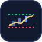
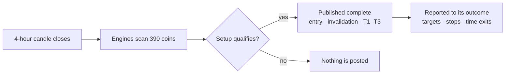
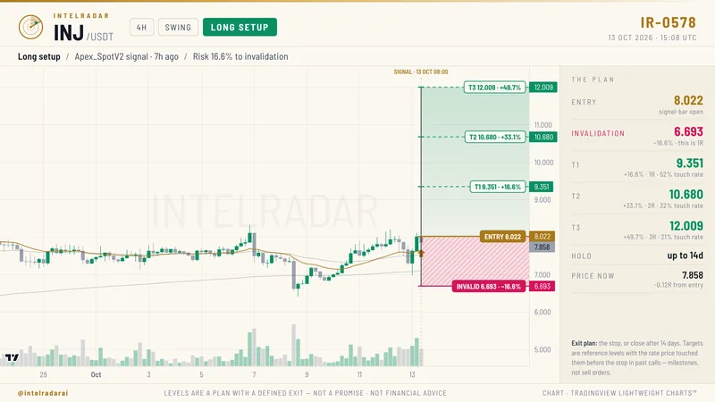
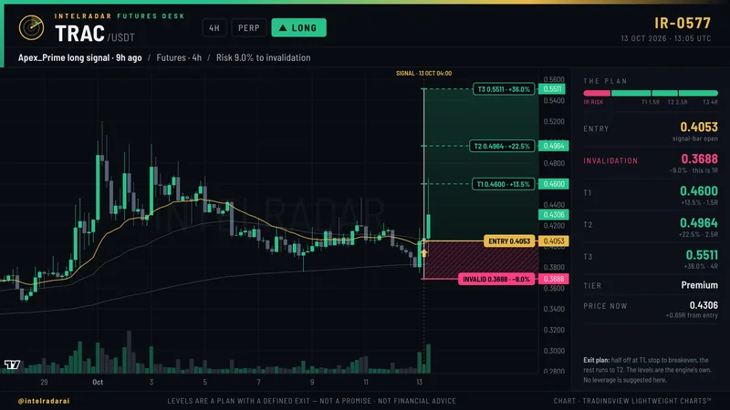
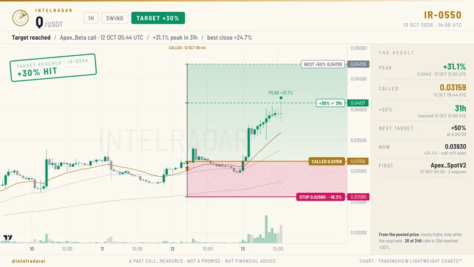
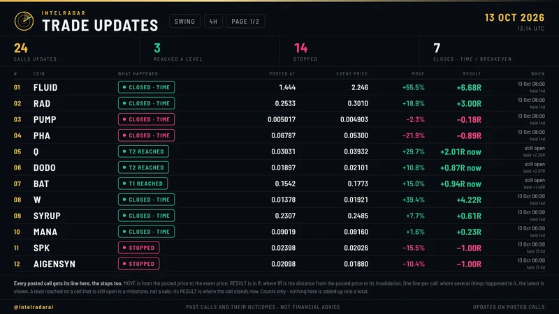

  

**[Website](https://cypherbird.github.io/intelradar-research/)** &nbsp;·&nbsp;
[Products](#products) &nbsp;·&nbsp;
[How it works](#how-a-setup-is-made) &nbsp;·&nbsp;
[Methodology](#methodology) &nbsp;·&nbsp;
[Roadmap](#roadmap) &nbsp;·&nbsp;
[Community](#community)

 

## About

> **IntelRadar Research is a quantitative research desk for crypto markets.**
> Rules-based engines scan 390 coins on Binance after every 4-hour close and publish complete, documented
> setups — entry, invalidation and targets — each one reported through to its outcome.

  

 

## Products

<table>
  <tr>
    <td width="33%" valign="top">
      
      <h3>Free tier</h3>
      
      
A daily sample of the desk's research, delivered on Telegram.

      <ul>
        <li>2 Swing setups a day</li>
        <li>2 Position setups a day</li>
        <li>2 Futures setups a day</li>
        <li>Every target report</li>
      </ul>
      <a href="https://t.me/intelradarai"><b>Join the Free tier →</b></a>
    </td>
    <td width="33%" valign="top">
      
      <h3>Pro Desk</h3>
      
      
The complete research desk, as it happens.

      <ul>
        <li>Every setup, all three books</li>
        <li>Live T1–T3, stop and close updates</li>
        <li>Market Pulse and BTC Quant desk</li>
        <li>Instant BTC alerts</li>
      </ul>
      <a href="https://x.com/intelradarai"><b>Get early access →</b></a> 
      Opens at 2,000 followers on X.
    </td>
    <td width="33%" valign="top">
      
      <h3>TradingView Pro Indicators</h3>
      
      
IntelRadar research levels, directly on your own charts.

      <ul>
        <li>Setups and invalidation levels</li>
        <li>Target ladders with touch rates</li>
        <li>Built on the desk's own rules</li>
      </ul>
      <a href="#roadmap"><b>See the roadmap →</b></a>
    </td>
  </tr>
</table>

 

## How a setup is made

Three research books, each with its own engines, timeframe and exit rules:

| Book | Market | Timeframe | What every setup carries |
| :--- | :--- | :--- | :--- |
| **Swing** | Spot | 4-hour | Entry, invalidation, T1–T3 with historical touch rates, 14-day holding period |
| **Position** | Spot | Daily | The same complete plan, built for the larger moves |
| **Futures** | Perpetuals | 4-hour | Long and short setups, risk defined in R, written exit plan |
| **Market desk** | Bitcoin | 4-hour · live | BTC Quant read, daily Market Pulse, instant alerts on significant moves |

 

## Documented setups

<table>
  <tr>
    <td width="50%"> <b>Swing setup</b> Entry, invalidation, three targets with touch rates, holding period and exit plan.</td>
    <td width="50%"> <b>Futures setup</b> Risk defined in R, targets at 1.5R, 2.5R and 4R, written exit plan.</td>
  </tr>
  <tr>
    <td width="50%"> <b>Target report</b> Measured from the published price while the stop held, with its 30-day base rate.</td>
    <td width="50%"> <b>Outcome report</b> Every published setup reported to its outcome, including stops and time exits.</td>
  </tr>
</table>

Unedited deliveries from 13 October 2026, generated automatically by the engines.

 

## Methodology

Every engine earns its place. These are the standards each one is held to, before release and after.

| | Standard | In practice |
| :---: | :--- | :--- |
| **01** | **Rules before results** | Each test is specified before it is run, so the outcome is measured, never tuned to fit. |
| **02** | **Out-of-sample validation** | An engine must hold on data it has never seen, walked forward through time. |
| **03** | **Costs included** | Exchange fees and slippage are part of every test, so results reflect what is tradable. |
| **04** | **No lookahead** | Signals use closed candles only. No calculation can use a price that did not exist yet. |
| **05** | **Statistical discipline** | No claim before 30 trades; the live forward test is assessed only after 60. |
| **06** | **Measured in the open** | Every published setup is tracked from the published price to its outcome, targets and stops alike. |

 

## Roadmap

  

<b>Roadmap in detail</b>

 

| Quarter | Phase | Status | Highlights |
| :--- | :--- | :--- | :--- |
| **Q2 2026** | Foundation |  | Research engines and a lookahead-free backtester on Binance data; first strategies validated out of sample |
| **Q3 2026** | Research platform |  | Market-regime routing; Swing and Position books publishing since August; BTC Quant and Futures desks; outcome reporting |
| **Q4 2026** | Launch |  | Futures setups; 24/7 cloud production desk; Free tier on Telegram; website; Pro Desk early access |
| **Q1 2027** | Pro Desk |  | Every setup as it happens; live updates; Market Pulse, BTC Quant desk and instant alerts |
| **Q2 2027** | TradingView Pro Indicators |  | Setups, invalidation levels and target ladders on your own TradingView charts |
| **Beyond** | Platform expansion |  | Public performance dashboard · web research portal · mobile alerts · partner and API access |

The roadmap is indicative: priorities follow research results and community feedback.

 

## Community

| | |
| :--- | :--- |
| **X** | Research notes, launches and feedback: [**@intelradarai**](https://x.com/intelradarai) |
| **Telegram** | The Free tier, live today: [**t.me/intelradarai**](https://t.me/intelradarai) |
| **Ideas** | Feature requests shape the roadmap. Reply or send a message on X. |

## About this repository

This repository hosts the public website of IntelRadar Research — static HTML and CSS with no cookies, no tracking
and a strict Content-Security-Policy. The research engines themselves are proprietary and are not part of this
repository. Maintainers: see [`docs/MAINTAINING.md`](docs/MAINTAINING.md).

## Disclaimer

IntelRadar Research publishes research, not investment advice. Crypto assets are highly volatile and you can lose
all of your money. Past results do not predict future results. Nothing here is an offer or a solicitation to buy or
sell any asset. See the full [risk disclosure](https://cypherbird.github.io/intelradar-research/legal.html).

 

**Clarity is freedom.** 
Navigate open markets with evidence.

© 2026 IntelRadar Research

